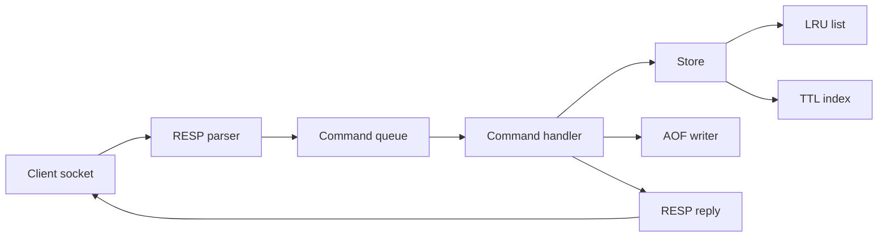

# Mini Redis architecture

A teaching clone of a Redis-like TCP server: RESP over Node `net`, an in-memory store with LRU + TTL, and append-only persistence (AOF).

## Request flow

End-to-end path:

1. **Client socket** — bytes arrive on a TCP connection (`src/server.ts`). One `data` event is not one command; the server concatenates into a per-connection buffer.
2. **RESP parser** — `parseCommand` (`src/resp.ts`) pulls one complete array-of-bulk-strings (or a legacy inline line). Incomplete input waits for more bytes; invalid framing gets an error reply.
3. **Command queue** — every parsed command is chained on one process-wide promise queue so mutations and AOF records stay ordered (Redis-like single-threaded execution).
4. **Command handler** — `execute` (`src/commands.ts`) looks up a handler in a command table (`PING`, `SET`, `GET`, …).
5. **Store** — `Store` (`src/store.ts`) holds values in a `Map`, maintains an O(1) doubly linked **LRU** list, and a separate **TTL index** for keys with deadlines. Lazy expiry runs on access; active expiry samples the TTL index in the background.
6. **AOF writer** — mutating commands may append a RESP record (`src/aof.ts`). Durability depends on `APPENDFSYNC` (`always` / `everysec` / `no`). Startup replay is `src/replay.ts`.
7. **Reply** — the handler’s RESP buffer is written back on the same socket (`always` waits for write+fsync first; `everysec`/`no` reply as soon as the record is queued).

Module map:

| File | Role |
| --- | --- |
| `src/index.ts` | Process entry |
| `src/config.ts` | Env defaults (`PORT`, `MAXMEMORY_MB`, `APPENDFSYNC`, …) |
| `src/server.ts` | TCP, queue, wiring |
| `src/resp.ts` | Parse / encode RESP |
| `src/commands.ts` | Command table + handlers |
| `src/store.ts` | Map + LRU + TTL |
| `src/aof.ts` | Batched append + fsync policy |
| `src/replay.ts` | AOF → store on startup |

## Design decisions and trade-offs

### Why `Map` + doubly linked list for LRU?

- `Map.get` / `Map.set` are average O(1) for the key → node lookup.
- A doubly linked list stores recency: move a node to the MRU end on access (`touch`), evict from the LRU end when over `maxmemory`.
- Together, **lookup, refresh, and eviction are O(1)** — unlike scanning an array by timestamp.
- Trade-off: extra pointers per entry and careful `unlink` logic (head/tail are easy to get wrong). Memory accounting is still approximate (key/value UTF-8 bytes + fixed overhead), not RSS.

### Why lazy + active expiry?

- **Lazy:** on `GET` / `TTL` / etc., if `expiresAt <= now`, delete then. Clients never see a value past its deadline on access. Cheap when few expired keys are touched.
- **Active:** a timer samples only keys in the **TTL index** (~20 per round), deletes expired ones, and repeats while a large fraction expired — with a **time budget** so the event loop is not blocked.
- Trade-off: active expiry is **not exact**. Untouched expired keys can linger briefly until a sample hits them or something accesses them. You trade perfect immediate reclaim for bounded CPU (same idea as Redis).

### Why a single command queue?

- One in-memory store and one AOF stream without locks.
- Preserves a clear total order: command N’s store mutation and AOF record happen before N+1.
- Trade-off: throughput is capped by one Node event loop; a slow `APPENDFSYNC=always` fsync stalls every client’s commands, not only the writer’s connection.

### AOF durability and `APPENDFSYNC`

Mutating commands are logged as RESP. Expiry is stored with absolute deadlines (`PXAT` / `PEXPIREAT`) so offline time still counts.

| Mode | When the client gets the reply | Typical crash loss |
| --- | --- | --- |
| `always` | After `write` + `fsync` | Little beyond an un-acked in-flight command |
| `everysec` (default) | As soon as the record is **queued** (batching still applies) | About the last ~1s since the last fsync, plus an unflushed batch |
| `no` | Same queue timing as `everysec` | Whatever the OS has not flushed; no periodic `fsync` |

Trade-off: `always` is safest and slowest; `everysec` mirrors Redis’s common default; `no` maximizes speed and risk. Ctrl+C drains the queue (and fsyncs on shutdown for `always` / `everysec`).

## Known limitations

- **Single-threaded** — one command queue, one event loop; no I/O threads like Redis’s bio threads.
- **No AOF rewrite / compaction** — the file only grows; no BGREWRITEAOF.
- **LRU eviction is not AOF-logged** — keys removed only for `maxmemory` can reappear after restart if older SET records are still in the AOF.
- **Limited command set** — strings-focused: no lists/hashes/sets/sorted sets, no `MULTI`/`EXEC`, pub/sub, Lua, streams, modules.
- **No auth, TLS, replication, cluster, or RDB**.
- **Approximate maxmemory** — not process RSS; large overheads (V8, buffers) are invisible to the cap.
- **Protocol subset** — arrays of bulk strings (+ simple inline); not every RESP edge case or command arity Redis accepts.
- **Truncated AOF tail** — replay stops at the first incomplete/invalid record; the valid prefix is kept.
- **Windows vs Linux** — for performance claims, prefer same-machine Linux/WSL2 comparisons; see `bench/README.md`.

This project is for learning and interviews, not production Redis replacement.
